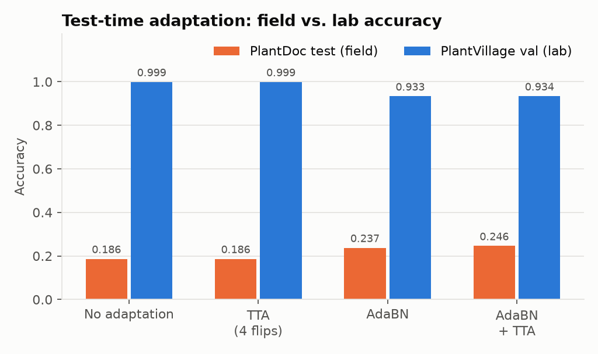
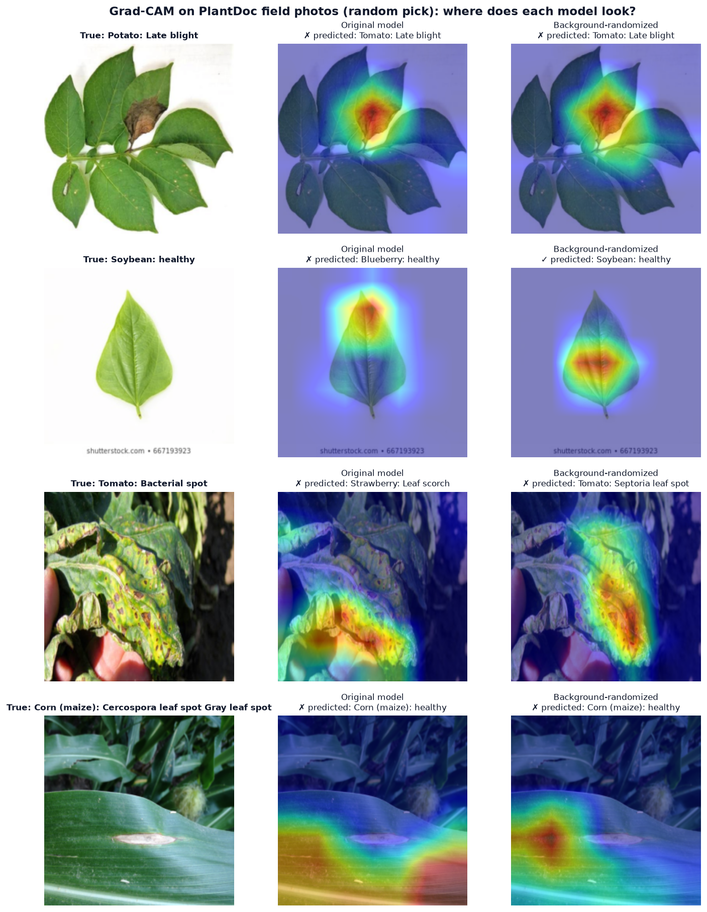
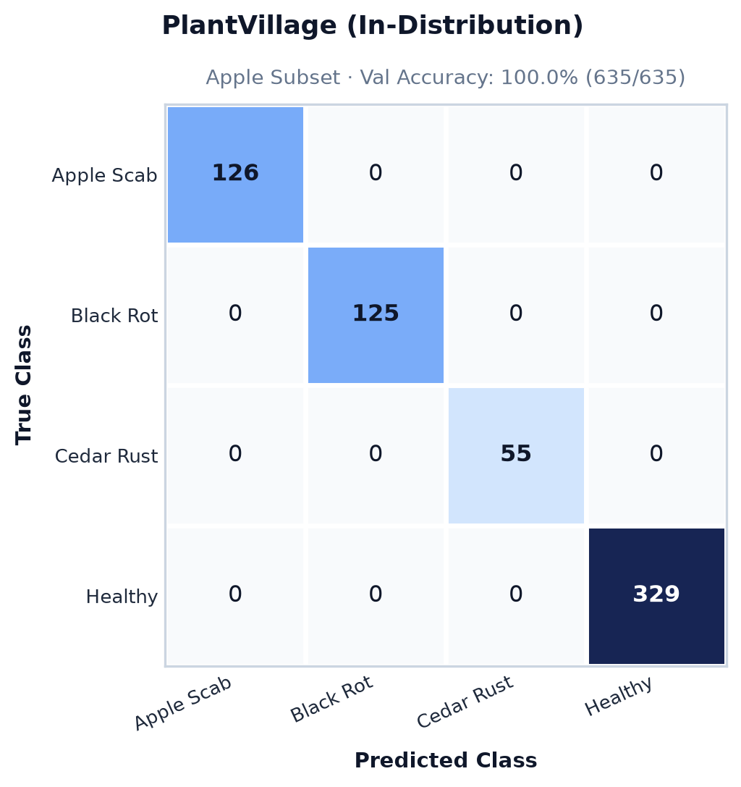
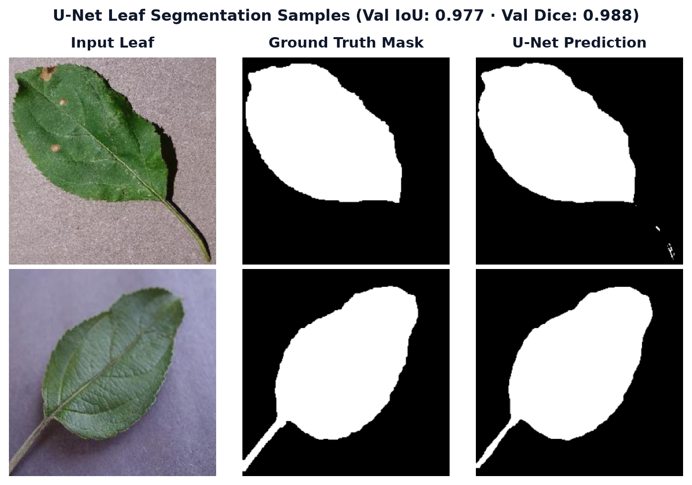
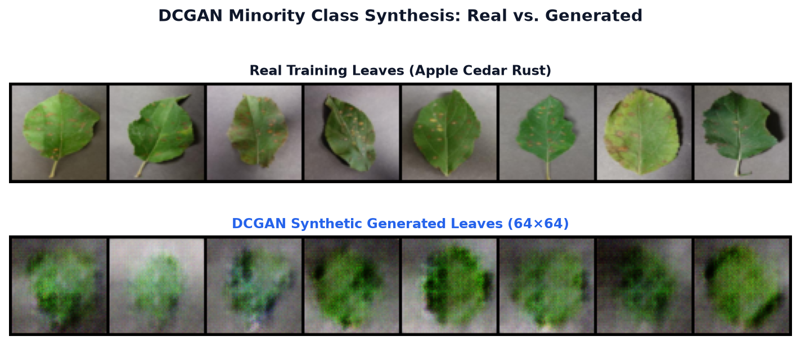

# Plant Disease Recognition: Lab-to-Field Generalization

[](https://colab.research.google.com/github/tajammulbasheer/plant_leaf_diseases_detection/blob/main/notebooks/train_on_colab.ipynb)
[](https://github.com/tajammulbasheer/plant_leaf_diseases_detection/actions/workflows/ci.yml)
[](https://huggingface.co/spaces/tajammulbasheer/plant-leaf-disease-detection)

Plant disease classification on the full **PlantVillage** dataset (38 classes, 14 crops), plus four
experiments that test what a near-perfect PlantVillage score actually means:

- **Label efficiency**: full supervision vs. 20 labels per class vs. 20 labels + pseudo-labeling
- **Generalization**: the same model tested on **PlantDoc**, real field photos of the same diseases
- **Continual learning**: adding new diseases one at a time from 20 examples each, measuring forgetting
- **Localization without boxes**: Grad-CAM heatmaps turned into lesion bounding boxes, using only image labels

Try it: live demo on [Hugging Face Spaces](https://huggingface.co/spaces/tajammulbasheer/plant-leaf-disease-detection). Upload a leaf photo to get the diagnosis and a Grad-CAM heatmap.</br>
Plus a U-Net leaf segmenter and a DCGAN for minority-class synthesis on the Apple subset.


## Key findings

- A standard EfficientNet-B0 reaches **99.9% accuracy** on PlantVillage, but on **236 PlantDoc field photos**
  of the 27 classes both datasets share, the same model gets only **18.6% accuracy (0.14 macro-F1)**,
  against 99.9% on the lab photos of those classes. PlantVillage's uniform lab backgrounds make
  in-distribution accuracy a poor guide to real-world performance.
- Cheap test-time fixes don't close that gap. Flip-based test-time augmentation changes nothing; AdaBN
  (re-estimating BatchNorm statistics on unlabeled field photos) lifts field accuracy to **24.6%** with
  TTA (McNemar p = 0.03), but costs lab accuracy (99.9% → 93.4%). The shortcut is in the learned features,
  not just in their statistics.
- Retraining with randomized backgrounds (each training leaf pasted onto a random texture from DTD, with
  probability 0.8) lifts field accuracy to **30.9%** (+42 / −13 images vs. the original model, McNemar
  p < 0.001) and keeps 99.8% on PlantVillage. In the sample Grad-CAM figure, the original model looks at
  the fingers holding a tomato leaf, and the retrained one looks at the lesions. That is still far from usable:
  field photos also differ in lighting, viewpoint and the number of leaves in the frame.
- A specialist trained on the 4 Apple classes does better on PlantDoc's Apple photos (**51.7%**), but that
  test has only 29 images.
- With only **20 labeled images per class**, accuracy stays at **95.2%** across all 38 classes, and
  pseudo-labeling the unlabeled images raises it to **97.4%**.
- When new diseases are added sequentially, naive fine-tuning forgets almost everything it knew;
  exemplar replay + knowledge distillation substantially reduces that forgetting.

## Results

All numbers are produced by `src/utils/generate_report.py`, which fills in the block below from the
experiment outputs. Nothing here is typed by hand.

<!-- RESULTS:START -->
### Classifier: 38-class PlantVillage

| Mode | Labeled images / class | Val accuracy | Val macro-F1 | Epochs run |
|------|------------------------|--------------|--------------|------------|
| Full supervised | all | 0.9991 | 0.9989 | 20/20 |
| Few-shot | 20 | 0.9517 | 0.9406 | 25/25 |
| Semi-supervised | 20 + pseudo-labels | 0.9741 | 0.9728 | 25/25 |

<p align="center">
  
  
</p>

### Cross-dataset generalization (38-class model, every PlantDoc class with a PlantVillage match)

| Test set | Classes | Images | Accuracy | Macro-F1 |
|---|---|---|---|---|
| PlantVillage val (same classes) | 27 | 7382 | 0.9989 | 0.9988 |
| PlantDoc test (field photos) | 27 | 236 | 0.1864 | 0.1399 |

Generalization gap: **0.812** accuracy, **0.859** macro-F1. *27 PlantDoc classes with a PlantVillage equivalent, 236 PlantDoc test images; the model predicts over all 38 classes.*

<p align="center"></p>

### Test-time adaptation on PlantDoc (38-class model, no retraining, no PlantDoc labels)

| Method | PlantDoc test accuracy | PlantDoc macro-F1 | Images fixed / broken vs. no adaptation (McNemar p) | PlantVillage val accuracy |
|---|---|---|---|---|
| No adaptation | 0.1864 | 0.1399 | — | 0.9989 |
| TTA (4 flips) | 0.1864 | 0.1449 | +4 / −4 (p = 1.000) | 0.9989 |
| AdaBN | 0.2373 | 0.1790 | +22 / −10 (p = 0.050) | 0.9331 |
| AdaBN + TTA | 0.2458 | 0.1933 | +25 / −11 (p = 0.029) | 0.9336 |

*AdaBN re-estimates BatchNorm statistics on 2331 unlabeled PlantDoc train images (11 exact copies of test images excluded); model weights are unchanged. Scored on the same 236 PlantDoc test / 7382 PlantVillage val images (27 classes) as above. McNemar: exact two-sided test on per-image correctness.*

<p align="center"></p>

### Background randomization (38-class model retrained with leaves on random backgrounds)

| Model | PlantVillage val (38 classes) | PlantVillage val (27 shared classes) | PlantDoc test accuracy | PlantDoc macro-F1 | Images fixed / broken vs. original (McNemar p) |
|---|---|---|---|---|---|
| Original (lab backgrounds) | 0.9991 | 0.9989 | 0.1864 | 0.1399 | — |
| Background-randomized (DTD) | 0.9982 | 0.9974 | 0.3093 | 0.2188 | +42 / −13 (p < 0.001) |

*Training images had their background replaced by a random DTD texture crop with probability 0.8, using leaf masks from PlantVillage's background-removed copies; all other settings as the original. Validation and test images are unchanged. McNemar: exact two-sided test on per-image correctness on the same PlantDoc test images.*

<p align="center"></p>

### Cross-dataset generalization (Apple classes, PlantVillage → PlantDoc)

| Test set | Accuracy | Macro-F1 |
|---|---|---|
| PlantVillage (in-distribution) | 1.0000 | 1.0000 |
| PlantDoc (field photos) | 0.5172 | 0.3750 |

Generalization gap: **0.483** accuracy, **0.625** macro-F1. *Note: 'Black_rot' has no PlantDoc equivalent and is excluded from this OOD eval.*

<p align="center"></p>

<p align="center">
  
  
</p>

### Class-incremental few-shot learning (Apple classes)

| Strategy | Final avg. accuracy | Avg. forgetting (lower is better) |
|---|---|---|
| Naive fine-tuning | 0.3341 | 0.9989 |
| Replay + distillation | 0.5173 | 0.4146 |

<p align="center"></p>

### Leaf segmentation (U-Net, Apple classes)

| Val IoU | Val Dice | Train / val images |
|---|---|---|
| 0.9771 | 0.9883 | 2854 / 317 |

<p align="center"></p>

*Training precision: fp32 for every run above.*

### Sample outputs

<p align="center"></p>

<details>
<summary><b>Experimental: DCGAN Minority Class Synthesis (Cedar Apple Rust)</b></summary>
<br/>
<p align="center"></p>
<p align="center"><i>Synthetic leaves generated at 64×64 resolution to explore generative augmentation for scarce minority classes. Retained as a qualitative exploratory baseline (downstream classification gains are not claimed without higher-resolution generation).</i></p>
</details>

<!-- RESULTS:END -->

## Approach

| Component | What it does | Code |
|---|---|---|
| Data preparation | Clones the original PlantVillage repo, seeded stratified 80/20 split, Apple subset, U-Net masks | `src/data/prepare_plantvillage.py` |
| Classifier | ImageNet-pretrained EfficientNet-B0 with a small MLP head; `full`, `few_shot`, `semi_supervised` modes | `src/training/train_classifier.py` |
| Pseudo-labeling | Each epoch, predicts on a random slice of unlabeled images and trains on those above 0.95 confidence | same file |
| Cross-dataset eval | Tests the 38-class model on all 27 PlantDoc classes that map to PlantVillage (per-class chart), and the Apple classifier on PlantDoc's Apple photos (confusion matrices) | `src/eval/` |
| Test-time adaptation | Flip TTA and AdaBN (BatchNorm statistics from unlabeled PlantDoc train photos, test duplicates excluded); methods fixed in advance, paired McNemar test against no adaptation | `src/eval/test_time_adaptation.py` |
| Background randomization | Leaf masks from PlantVillage's background-removed copies; during training, each leaf is pasted onto a random DTD texture crop with probability 0.8 (opt-in `--background-dir` / `--mask-dir`) | `src/data/build_leaf_masks.py`, `src/data/dataset.py` |
| Class-incremental | Base task (healthy, scab) with full data, then black rot and cedar rust from 20 shots each; naive vs. replay + distillation | `src/incremental/` |
| Grad-CAM boxes | Hand-written Grad-CAM, thresholded into the largest connected region as a pseudo box | `src/interpretability/` |
| Segmentation | U-Net trained with BCE + Dice on masks derived from PlantVillage's background-removed images | `src/training/train_segmentation.py` |
| Synthetic data | Per-class DCGAN at 64×64 for the rarest Apple class | `src/training/train_gan.py` |

### Design decisions

- **Data from the original source, not a Kaggle mirror.** The popular "New Plant Diseases Dataset
  (Augmented)" mirror places augmented copies of the same leaf in both train and validation, which
  inflates validation accuracy. This repo clones the raw images and splits them itself.
- **Report macro-F1, not just accuracy.** PlantVillage classes are imbalanced; macro-F1 weights each disease equally.
- **Pseudo-labels hold file paths, not image tensors,** and train in normal mini-batches, so memory use
  doesn't grow with the unlabeled pool.
- **Class-incremental evaluation masks unseen classes.** After each task the model can only predict
  classes it has been taught, and distillation is applied only over the teacher's known classes.
- **Classifier training runs checkpoint each epoch** and support `--resume`, making long or interrupted Colab/local sessions recoverable (auxiliary U-Net, GAN, and incremental experiments train in focused single sessions).

### Limitations

- The train/validation split is random per image, not grouped by physical leaf, so some near-duplicate
  photos of one leaf may land on both sides; this is why the PlantDoc result is the more trustworthy number.
- The class-incremental benchmark has only 4 classes and 3 tasks; it shows the method works, not how it scales.
- Benchmark numbers are from single seeded runs; few-shot sampling and incremental task order vary across random seeds, so reporting mean ± std over multiple seeds is planned for future scaling.
- PlantDoc's test split is small (236 images over 27 classes, 4–12 per class), so per-class PlantDoc
  accuracies are noisy; the overall figure is the more reliable one.
- Background randomization is one run with settings fixed in advance (p = 0.8, DTD textures), not tuned on
  PlantDoc. About 2.2% of PlantVillage images have no matching background-removed copy; those are always used unchanged.
- DCGAN samples are 64×64; a diffusion model would give higher fidelity at much higher compute cost.
- Grad-CAM boxes are not scored against ground-truth boxes (PlantVillage has none), and they can be
  loose: in the sample figure the cedar-rust heatmap is diffuse and its box covers almost the whole leaf.

## Reproduce

### Google Colab (recommended)

Click the **Open in Colab** badge above, select a T4 GPU, and run the cells top to bottom; the notebook
clones this repo itself. See **[docs/COLAB.md](docs/COLAB.md)** for the full walkthrough. No API keys or
accounts are needed beyond Google Drive.

Prefer your own GPU? **[docs/LOCAL.md](docs/LOCAL.md)** covers the same pipeline locally (WSL2 / Linux).

### Local

For a full local run on a CUDA GPU (one script, resumable, logs per step), see
**[docs/LOCAL.md](docs/LOCAL.md)** and `scripts/run_all.sh`. Step by step:

```bash
git clone https://github.com/tajammulbasheer/plant_leaf_diseases_detection.git
cd plant_leaf_diseases_detection
pip install -r requirements.txt
pip install -e .
python -m src.data.prepare_plantvillage --output-dir data --workdir . --cleanup-clone

python -m src.training.train_classifier --data-dir data/plantvillage_full \
    --output-dir runs/baseline_full --mode full --epochs 20
# ...other steps follow the notebook; then:
python -m src.utils.generate_report --run-dir runs --output-dir runs/report \
    --assets-dir assets --readme README.md
```

Each script prints its options with `--help`.

### Quick inference (single image)

To run disease classification and optional Grad-CAM localization on any leaf photo:

```bash
# Top disease predictions
python predict.py --image path/to/leaf.jpg --checkpoint runs/baseline_full/best_model.pt

# Top predictions + Grad-CAM heatmap & pseudo bounding box visualization
python predict.py --image path/to/leaf.jpg --checkpoint runs/baseline_full/best_model.pt --cam
```

### Interactive web demo (Gradio)

Launch the interactive local web app with drag-and-drop leaf image testing, real-time disease diagnosis, Grad-CAM attention heatmap visualization, and 1-click sample images:

```bash
pip install gradio
python app.py
```

It loads `best_model.pt` from `baseline_apple_only/`, `baseline_full/` and `baseline_full_bgrand/` under `$RUN_DIR` if set,
otherwise from `runs/`, `~/runs/plant_leaf` or the Colab Drive folder.

## Repository structure

```
app.py                          interactive Gradio web demo (diagnosis & Grad-CAM visualizer)
predict.py                      single-image inference CLI with optional Grad-CAM overlay
pyproject.toml                  package metadata and standard editable installation (pip install -e .)
samples/                        sample leaf photos for 1-click testing in the web demo
src/
  data/
    dataset.py                 class-folder dataset, few-shot sampling, background swap, transforms, seeding
    prepare_plantvillage.py    download, split, Apple subset, segmentation masks
    build_leaf_masks.py        leaf masks for the 38-class split (background randomization)
  models/
    classifier.py              EfficientNet / ResNet classifier
    unet.py                    U-Net
    gan.py                     DCGAN generator and discriminator
  training/
    train_classifier.py        full / few-shot / semi-supervised, resumable
    train_segmentation.py      U-Net training with IoU / Dice
    train_gan.py               per-class DCGAN
  eval/
    plantdoc.py                PlantDoc loader (class mapping)
    cross_dataset_eval.py      in- vs. out-of-distribution evaluation
    test_time_adaptation.py    TTA and AdaBN on PlantDoc (no retraining, no PlantDoc labels)
  incremental/
    train_incremental.py       class-incremental few-shot learning
    metrics.py                 accuracy matrix, forgetting
  interpretability/
    gradcam.py                 Grad-CAM
    pseudo_boxes.py            heatmap → pseudo bounding box
  utils/
    metrics.py                 accuracy, macro-F1 / precision / recall
    generate_report.py         results tables, figures, README update
    make_figures.py            README sample figures (U-Net, Grad-CAM, DCGAN) from saved checkpoints
    figure_style.py            shared figure palette
tests/                          unit tests (pytest)
.github/workflows/ci.yml        CI: unit tests + CPU smoke test on every push
notebooks/train_on_colab.ipynb  Colab runner (calls the scripts above)
scripts/run_all.sh              local runner: same steps and settings as the notebook
scripts/smoke_test.sh           end-to-end check of every script on tiny synthetic data
docs/COLAB.md                   step-by-step Colab guide
docs/LOCAL.md                   local GPU guide (setup, tmux, resuming, troubleshooting)
assets/                         figures used in this README
```

## Data and credits

- **PlantVillage**: Hughes & Salathé, *An open access repository of images on plant health to enable the
  development of mobile disease diagnostics*, 2015. Images from
  [spMohanty/PlantVillage-Dataset](https://github.com/spMohanty/PlantVillage-Dataset).
- **PlantDoc**: Singh et al., *PlantDoc: A Dataset for Visual Plant Disease Detection*, CoDS-COMAD 2020.
  [pratikkayal/PlantDoc-Dataset](https://github.com/pratikkayal/PlantDoc-Dataset).
- **DTD** (background textures): Cimpoi et al., *Describing Textures in the Wild*, CVPR 2014.
  [robots.ox.ac.uk/~vgg/data/dtd](https://www.robots.ox.ac.uk/~vgg/data/dtd/).

Datasets are downloaded at run time and are not redistributed in this repository.

## License

MIT. See [LICENSE](LICENSE).
